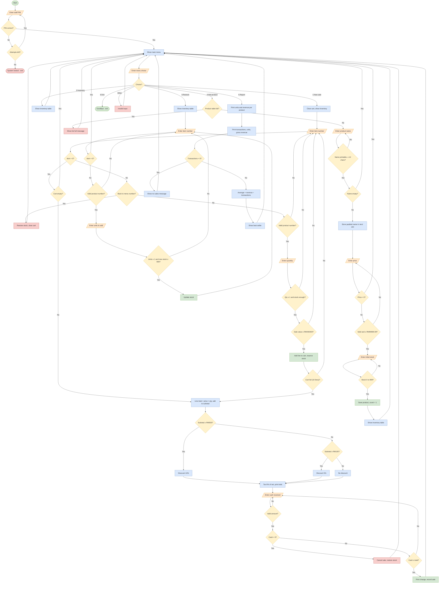
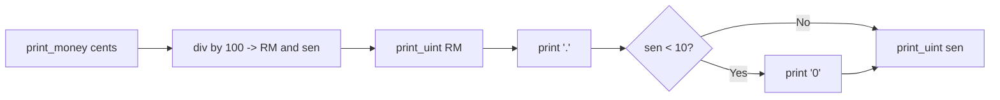

# APEX Computer Shop – Inventory & POS (NASM, 32-bit x86, Linux)

A console point-of-sale and inventory system written in pure assembly (no libc, only `int 0x80` system calls).

## Build & run (Linux, or WSL)
```bash
sudo apt install nasm          # once (on 64-bit systems ld handles -m elf_i386)
make run                       # or:
nasm -f elf32 apex_pos.asm -o apex_pos.o && ld -m elf_i386 apex_pos.o -o apex_pos && ./apex_pos
```
Staff PIN: **1234** (3 attempts, then locked).

## Ubuntu (WSL) setup guide

### Guide 1: Ubuntu's own folder (`~/asm-pos`)
1. Go to the folder: `cd ~/asm-pos`
2. Check the source file is there: `ls` (you should see `apex_pos.asm`; if missing, create it with `nano apex_pos.asm` and paste the code, save with Ctrl+O then Enter, exit with Ctrl+X)
3. Assemble: `nasm -f elf32 apex_pos.asm -o apex_pos.o`
4. Link: `ld -m elf_i386 apex_pos.o -o apex_pos`
5. Run, then enter the PIN `1234`: `./apex_pos`

### Guide 2: the D: drive (`/mnt/d/...`)
1. Go to the folder: `cd /mnt/d/Coding/APEX-Computer-Inventory-POS-System/asm-pos`
2. Check the files: `ls` (you should see `apex_pos.asm` and `Makefile`)
3. Assemble: `nasm -f elf32 apex_pos.asm -o apex_pos.o`
4. Link: `ld -m elf_i386 apex_pos.o -o apex_pos`
5. Run: `./apex_pos`

In either folder, steps 3-5 can be done with `make run` if `make` is installed.

## Functionality
| Menu | Feature |
|---|---|
| Login | PIN check, 3-attempt loop, lock-out |
| 1 New sale | Add items to a cart (max 10 lines), stock check, receipt, tiered discount, 6 % tax, cash payment, change |
| 2 View inventory | Table of all products with price, stock and status (In Stock / Low Stock / Out of Stock) |
| 3 Restock | Add units to a product (max 999) |
| 4 Add new product | Enter name (max 12 characters), price and initial stock; the 5 default products are kept (table holds up to 12) |
| 5 Sales report | Units/revenue per product, totals, average sale, best seller |
| 6 Exit | Clean exit |

Discount rules: subtotal ≥ RM100 → 5 %, ≥ RM500 → 10 %. Cancelling payment returns reserved stock.

## Where the required constructs are used
* **Arithmetic** – `mul/imul` (line total, RM→cents), `div` (discount %, tax %, average sale, digit extraction for printing), `add/sub` (subtotal, stock, change). Money is held as integer cents.
* **Loops** – `loop` (PIN compare, padding spaces); `rep movsb/stosb` (copying and padding a new product name); `cmp/jae/jmp` loops over the cart, inventory table, report rows, digit conversion, input parsing, input retries.
* **Jumps** – conditional (`je jne ja jb jle jz ...`) for validation, stock checks, discount tiers, divide-by-zero guard; unconditional `jmp` for the menu loop and retries; `call/ret` for subroutines.

## Additional control and robustness features
* **Access control** – staff PIN with 3 attempts, then the system locks and exits with an error code.
* **Input validation** – menu choices, item numbers, quantities, stock levels and cash amounts are checked. Letters, empty input, zero, out-of-range values, over-long numbers and trailing characters (for example `5.5` or `3x` where a whole number is needed) are rejected and the user is asked again. Product names must be 1-12 printable characters.
* **Stock control** – a sale cannot exceed available stock; stock is reserved when an item is added to the cart and returned if the sale is cancelled. The Status column shows "In Stock", "Low Stock" (below 5 units) or "Out of Stock" (0 units).
* **Cart control** – during a sale, `0` goes to checkout and the number after the last product returns to the main menu, cancelling the cart and restoring its stock.
* **Payment control** – cash may be entered with sen (for example `2861.04`); insufficient or invalid amounts are rejected and entering `0` cancels the sale and restores stock.
* **Product management** – new products can be added at run time (name, price, initial stock) while the 5 default products are kept; entering an empty name or a price of `0` cancels, and a full table (12 products) is reported.
* **Limits** – the cart holds at most 10 lines, one sale is capped at RM 400000 (keeps the 32-bit arithmetic from overflowing), stock at 999 units, a new product price at RM 99999.99, and the product table at 12 products.
* **Error safety** – divide-by-zero guard for the average sale in the sales report, and a clean exit if input ends.
* **Business rules** – tiered discounts (5 % / 10 %) and 6 % tax.
* **Reports** – per-product units and revenue (before discount and tax), transactions, units sold, gross revenue (what customers paid), average sale and best seller.
* **Usability** – coloured messages, yellow bordered tables with right-aligned columns, and money shown in RM with sen.

## System flowchart


### Subroutine flow (number printing)
`print_money_w` and `print_uint_w` use the same steps and then pad the text on the left to a fixed width, which keeps the table and receipt columns aligned.


